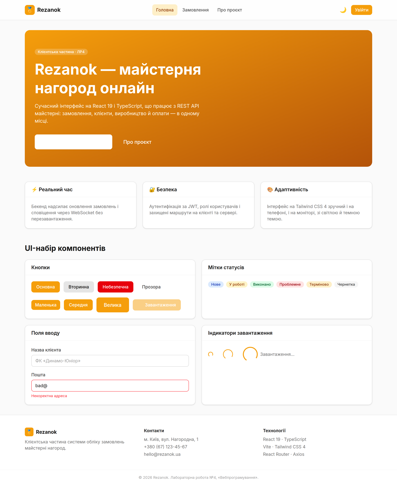
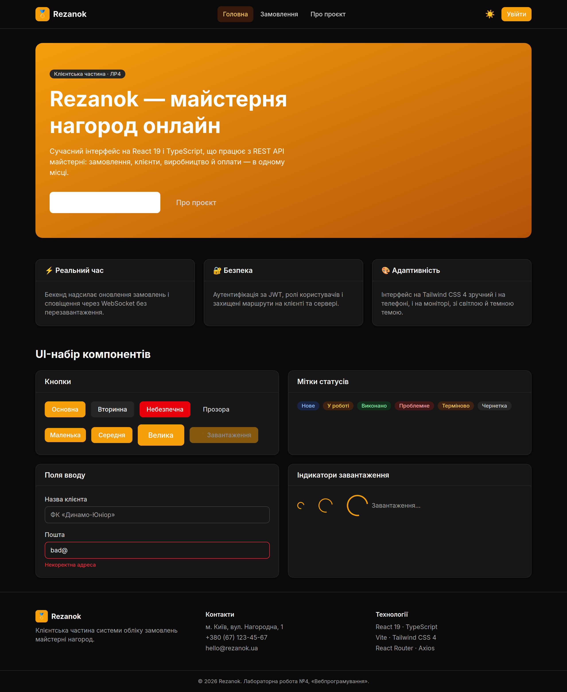
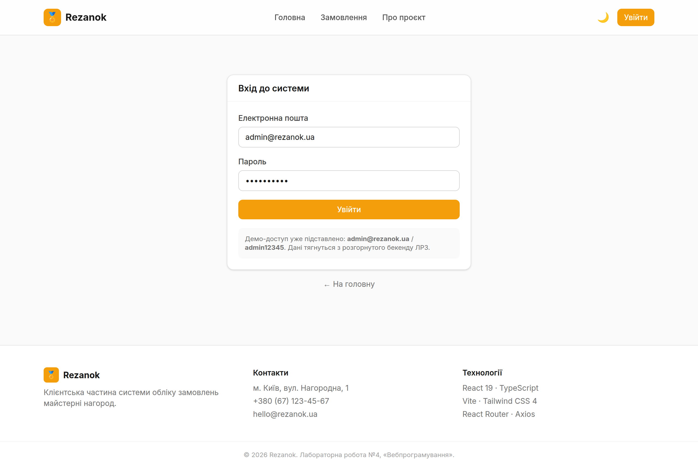
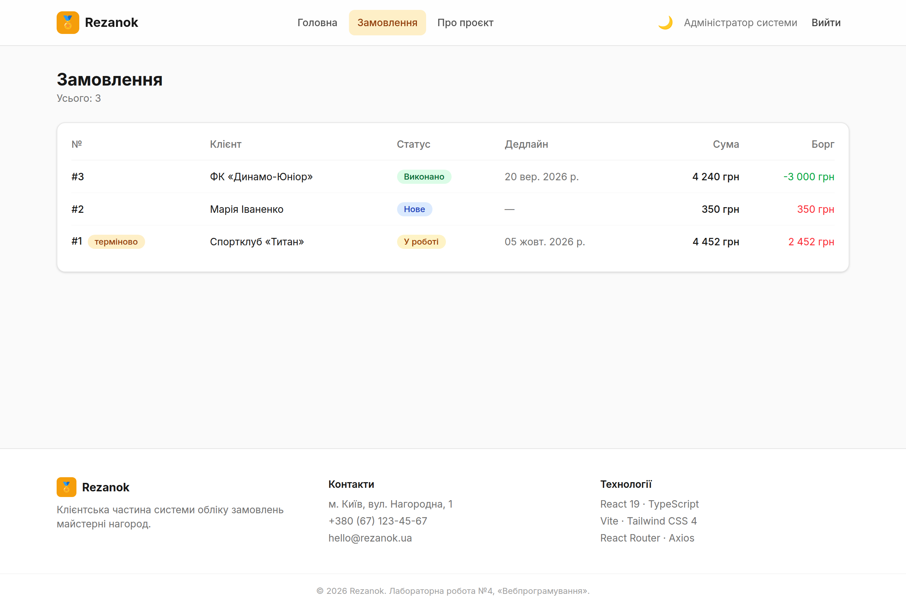
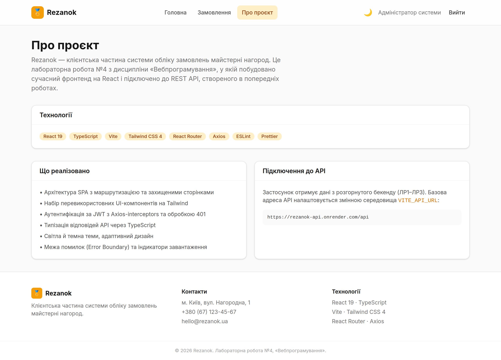
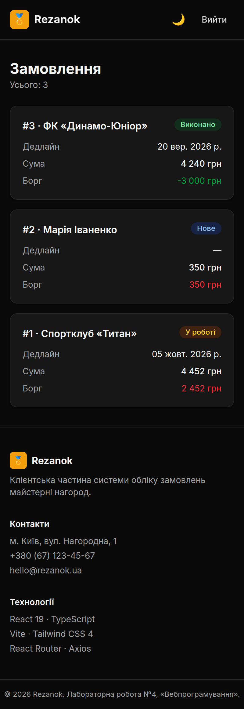

# Rezanok — клієнтська частина (React + TypeScript)

**Лабораторна робота №4 з дисципліни «Вебпрограмування»**
Виконала: Ткачук Евеліна

Клієнтська частина (SPA) системи обліку замовлень майстерні нагород **Rezanok**. Сучасний фронтенд на **React 19 + TypeScript**, зібраний **Vite** і стилізований **Tailwind CSS 4**, що працює з REST API, створеним у попередніх роботах (ЛР1–ЛР3).

🌐 **Бекенд, з яким працює застосунок:** https://rezanok-api.onrender.com
🔑 Демо-доступ: `admin@rezanok.ua` / `admin12345`

---

## 1. Мета та завдання роботи

Метою роботи є набуття практичних навичок створення сучасного React-проєкту з TypeScript, налаштування інструментів розробки та базової архітектури клієнтської частини з Tailwind CSS. Якщо попередні роботи створювали й розгортали серверну частину, то ця будує інтерфейс, що цю частину споживає: аутентифікує користувача, отримує дані через HTTP і показує їх у зручному адаптивному вигляді зі світлою й темною темами.

## 2. Технології

| Технологія | Версія | Призначення |
|---|---|---|
| React | 19 | Бібліотека інтерфейсу (ref як проп, без forwardRef) |
| TypeScript | 6 | Статична типізація |
| Vite | 8 | Збірка та dev-сервер із HMR |
| Tailwind CSS | 4 | Утилітарна стилізація (через плагін `@tailwindcss/vite`) |
| React Router | 8 | Клієнтська маршрутизація SPA |
| Axios | 1.x | HTTP-клієнт з interceptors |
| ESLint + Prettier | 10 / 3 | Статичний аналіз та форматування |

Проєкт вимагає **Node.js 20.19+ або 24 LTS**.

## 3. Архітектура та структура

Код організовано за зонами відповідальності з абсолютними імпортами через префікс `@/` (аліас на `src/`).

```
webprog-lab-04/
├── src/
│   ├── components/
│   │   ├── common/        Button, Input, Card, Badge, Loading
│   │   ├── layout/        Header, Footer, Layout
│   │   ├── ErrorBoundary.tsx   межа помилок (класовий компонент)
│   │   └── ProtectedRoute.tsx  захист маршрутів від неавторизованих
│   ├── pages/             Home, Login, Orders, About, NotFound
│   ├── services/          api.ts (axios + interceptors), auth, rezanok
│   ├── hooks/             useTheme, useAuth (+ AuthProvider, контекст)
│   ├── types/             api.types.ts — типи відповідей API
│   ├── utils/             format.ts (дати/валюта), cn.ts (класи)
│   ├── constants/         адреси, навігація, ключі сховища
│   ├── App.tsx            маршрутизація
│   └── main.tsx           точка входу (ErrorBoundary + AuthProvider)
├── .env / .env.example    VITE_API_URL, VITE_APP_NAME
├── eslint.config.js       плоский конфіг ESLint
├── vite.config.ts         плагіни React + Tailwind, аліас @/
└── tailwind — через @theme у src/index.css
```

## 4. UI-набір компонентів

Побудовано базовий набір перевикористовних компонентів, кожен — з типізованими пропсами. **Button** має варіанти оформлення (`primary`, `secondary`, `danger`, `ghost`), розміри (`sm`, `md`, `lg`) та стан завантаження `isLoading` (показує спінер і блокує кнопку). **Input** приймає підпис і повідомлення про помилку, а `ref` передається напряму як проп — у React 19 це працює без `forwardRef`. **Card** — контейнер з опційними заголовком і підвалом, **Badge** — кольорова мітка статусу, **Loading** — анімований спінер трьох розмірів. Усі компоненти підтримують світлу й темну теми через `dark:`-класи Tailwind. Вітрину набору зібрано на головній сторінці.

## 5. Маршрутизація

Маршрутизація — на React Router (усі імпорти з пакета `react-router`; `react-router-dom` у v8 вилучено). Сторінки вкладено у спільний каркас `Layout` (шапка з навігацією та перемикачем теми + підвал). Маршрути: `/` (головна з вітриною), `/login` (вхід), `/orders` (список замовлень, **захищений**), `/about` (про проєкт) і `*` (сторінка 404). Захищений маршрут обгорнуто компонентом `ProtectedRoute`, який під час перевірки сесії показує індикатор, а неавторизованого користувача перенаправляє на `/login`.

## 6. Робота з API

Усі запити йдуть через єдиний екземпляр Axios (`services/api.ts`) з базовою адресою зі змінної `VITE_API_URL`. Налаштовано два **interceptors**: запит автоматично отримує заголовок `Authorization: Bearer <token>`, якщо токен збережено, а відповідь із кодом **401** централізовано очищає токен і відправляє користувача на сторінку входу. Відповіді API суворо типізовані (`types/api.types.ts`): узагальнені `ApiResponse<T>` і `PaginatedResponse<T>` з `Pagination`, структура `ApiError`, а також доменні типи `User`, `Order`, `Client`. Сторінка замовлень демонструє реальну інтеграцію: вона завантажує дані з розгорнутого бекенду, показує індикатор завантаження, обробляє помилки й підтримує посторінкове виведення.

## 7. Аутентифікація

Стан аутентифікації зберігається у React-контексті (`AuthProvider` + хук `useAuth`). Під час входу застосунок звертається до `/auth/login`, зберігає access-токен у `localStorage` і підвантажує профіль; при перезавантаженні сторінки сесія відновлюється за збереженим токеном через `/auth/me`. Разом із interceptor-ом 401 та `ProtectedRoute` це дає цілісний потік: вхід → захищені дані → автоматичний вихід при простроченні токена.

## 8. Темна тема та адаптивність

Тему реалізовано класом `.dark` на кореневому `<html>` (директива `@custom-variant dark` у CSS), а не системним `prefers-color-scheme`, тож користувач може перемкнути її вручну; вибір зберігається в `localStorage` (хук `useTheme`). Кольори бренду задано через `@theme` як шкалу `primary-50…900`. Верстка адаптивна: на телефоні список замовлень показується картками, а на великих екранах — таблицею.

## 9. Надійність: Error Boundary

Непередбачені помилки рендерингу перехоплює **Error Boundary** — класовий компонент (функціональні цього не вміють), який замість «білого екрана» показує охайне повідомлення з кнопкою повернення на головну.

## 10. Запуск

```bash
# Потрібен Node.js 20.19+ (або 24 LTS)
npm install            # залежності
cp .env.example .env   # налаштування (за замовчуванням — розгорнутий бекенд)
npm run dev            # dev-сервер із HMR на http://localhost:5173
npm run build          # production-збірка (tsc + vite)
npm run lint           # перевірка ESLint
npm run format         # форматування Prettier
```

### Змінні середовища

| Змінна | Призначення | Приклад |
|---|---|---|
| `VITE_API_URL` | Базова адреса REST API | `https://rezanok-api.onrender.com/api` |
| `VITE_APP_NAME` | Назва застосунку | `Rezanok` |

## 11. Демонстрація роботи

**Головна сторінка (світла тема)** — hero, можливості системи та вітрина UI-набору (кнопки, мітки, поля, індикатори).



**Головна сторінка (темна тема)** — та сама сторінка після перемикання теми.



**Сторінка входу** — форма з полями та станом завантаження; демо-доступ підставлено.



**Список замовлень** — реальні дані з розгорнутого бекенду: статуси-мітки, відформатовані суми й дати, борг, пагінація. Доступний лише після входу.



**Сторінка «Про проєкт»** — опис і перелік технологій.



**Мобільний вигляд (темна тема)** — список замовлень картками на вузькому екрані.



## 12. Висновки

У результаті роботи створено сучасну клієнтську частину системи обліку замовлень майстерні нагород. Налаштовано повний інструментарій розробки (Vite, TypeScript, Tailwind CSS 4, ESLint, Prettier), побудовано архітектуру SPA з маршрутизацією та захищеними сторінками, розроблено набір типізованих UI-компонентів, реалізовано роботу з REST API через Axios з interceptors і типізацією відповідей, аутентифікацію за JWT, світлу й темну теми, межу помилок і допоміжні функції. Застосунок не лише відповідає вимогам методички, а й підключений до реального розгорнутого бекенду з попередніх робіт, що демонструє повний цикл «клієнт — сервер — база даних».
